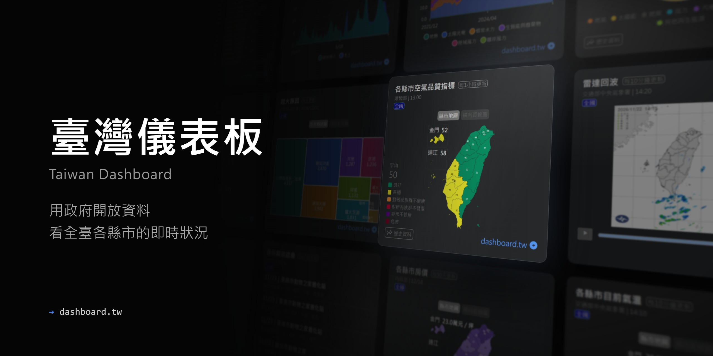

# 臺灣儀表板 Taiwan Dashboard

[](https://github.com/dashboard-tw/Taiwan-Dashboard/actions/workflows/ci.yml)
[](https://github.com/dashboard-tw/Taiwan-Dashboard/actions/workflows/github-code-scanning/codeql)
[](https://www.codefactor.io/repository/github/dashboard-tw/taiwan-dashboard)
[](LICENSE)
[](Taiwan-Dashboard-BE/go.mod)
[](Taiwan-Dashboard-FE/package.json)
[](docker)
[](https://dashboard.tw)
[](https://github.com/dashboard-tw/Taiwan-Dashboard/commits/main)
[](https://discord.gg/gU5gndueZH)



用政府開放資料，看全臺各縣市的即時狀況。

[網站](https://dashboard.tw) ｜ [開放資料 API](https://dashboard.tw/developers) ｜ [MCP](https://dashboard.tw/developers/mcp) ｜ [應用活化](https://dashboard.tw/showcase/app) ｜ [Discord](https://discord.gg/gU5gndueZH)

## 簡介

臺灣儀表板是雲際科技工作室的公益專案。網站把各機關的開放資料整理成圖表與地圖，包含天氣、空品、水情、電力、交通等主題，也保留歷史資料。

整理好的資料也透過開放資料 API 提供給開發者免費使用。

本專案參考了[臺北城市儀表板](https://github.com/taipei-doit/Taipei-City-Dashboard)的架構與設計，詳見 [NOTICE](NOTICE)。

## 功能

- 儀表板：二十多個主題、一百多個元件，可以切換全臺或縣市
- 地圖模式：雷達回波、衛星雲圖、風場、測站與設施
- 歷史資料：多數元件可以查過去的數值
- 開放資料 API：最新資料、歷史資料、每月大量下載，附 OpenAPI 文件
- MCP 伺服器：Claude、ChatGPT、Cursor 等 AI 工具可以直接查詢資料與 API 文件，支援 OAuth 登入授權
- 通知：註冊、新裝置登入、API 用量等通知信，支援 Brevo 與 SMTP，以及 Discord、Slack、Telegram 的管理通知
- 應用活化：展示使用本站 API 的作品

## 技術

| 部分 | 使用 |
|---|---|
| 後端 | Go、Gin、PostgreSQL 16、PostGIS |
| 前端 | Vue 3、TypeScript、Vite、ApexCharts、MapLibre GL |

## 專案結構

```
Taiwan-Dashboard-BE/   後端
Taiwan-Dashboard-FE/   前端
db-sample-data/        範例資料
docker/                本機啟動
docs/                  設定說明
```

## 快速開始

需要 Docker。

```bash
cd docker
docker compose up --build
```

啟動後打開 http://localhost:8080 。第一次啟動會建立資料表、匯入元件和[範例資料](db-sample-data/)。

要自動抓資料，把 `docker/.env.example` 複製成 `docker/.env`，填入各資料來源的金鑰，再啟動 worker：

```bash
docker compose --profile worker up --build
```

- 登入設定：[docs/oauth-setup.md](docs/oauth-setup.md)
- 資料來源：[Taiwan-Dashboard-BE/internal/sources/README.md](Taiwan-Dashboard-BE/internal/sources/README.md)

## 參與開發

請見[參與開發](CONTRIBUTING.md)與[行為準則](CODE_OF_CONDUCT.md)。資安問題請依照[資安政策](SECURITY.md)回報。

## 授權

程式碼採用 [AGPL-3.0](LICENSE) 授權。

網站上的資料依各機關的授權條款使用，多數為[政府資料開放授權條款－第 1 版](https://data.gov.tw/license)。
